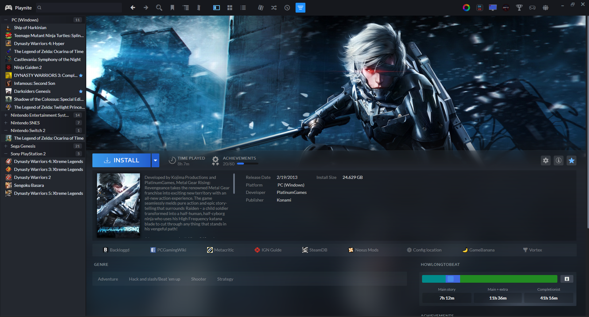
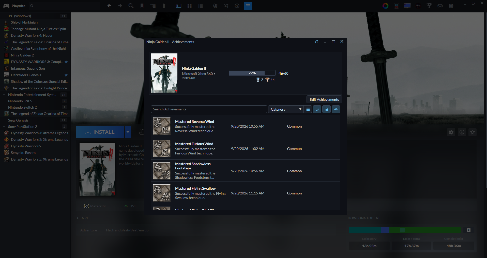

# Darker Helium
A darker variant of [Helium](https://github.com/darklinkpower/Helium), the Steam-inspired theme for [Playnite](https://github.com/JosefNemec/Playnite) Desktop Mode.

> **Credits:** Darker Helium is a fork of Helium by [darklinkpower](https://github.com/darklinkpower). All the original design and work belongs to them. This fork is based on Helium 1.71 and is not affiliated with or supported by the original author, so please don't report issues from this fork to them.

## What's different
- A darker color palette compared to the original Helium.
- Everything else (layouts, extension support, ThemeModifier options) is inherited from Helium.

## Installation
1. Download the latest packaged `pthm` theme file from the [Releases page](https://github.com/pahan3000/Darker-Helium/releases/latest).
2. Open the file and Playnite will install the theme.
3. In Playnite, go to **Settings → Appearance → General** and select **Darker Helium**.

Darker Helium has its own theme ID, so it installs alongside the original Helium instead of replacing it.

## Support and feature requests
If you encounter a bug or have a suggestion, please open an issue in the [Issues Tracker](https://github.com/pahan3000/Darker-Helium/issues).

Before submitting:
- **Search for existing issues** to avoid duplicates.
- Check whether it can already be done through Playnite's built-in settings or the [ThemeModifier plugin](https://playnite.link/addons.html#playnite-thememodifier-plugin).
- For bugs, include your Playnite version, theme version, logs and screenshots where possible.
- For bugs that also happen in the original Helium, consider reporting them [upstream](https://github.com/darklinkpower/Helium/issues).

This is a hobby project, so changes that benefit most users are prioritized over very personal tweaks.

## Extensions support
The theme supports a wide range of Playnite extensions, inherited from Helium.

- **Achievements:** [SuccessStory](https://playnite.link/addons.html#playnite-successstory-plugin) extension.
- **Alternative background images:** [BackgroundChanger](https://playnite.link/addons.html#playnite-backgroundchanger-plugin) extension.
- **Duplicate copies handling:** [DuplicateHider](https://playnite.link/addons.html#felixkmh_DuplicateHider_Plugin) extension.
- **Features icons:** [Library Management](https://playnite.link/addons.html#playnite-librarymanagement-plugin) extension.
- **Game cover banners and other functionality:** [ThemeExtras](https://playnite.link/addons.html#felixkmh_Extras_Plugin) extension.
- **Game statistics:** [GameActivity](https://playnite.link/addons.html#playnite-gameactivity-plugin) extension.
- **HowLongToBeat data:** [HowLongToBeat](https://playnite.link/addons.html#playnite-howlongtobeat-plugin) extension.
- **Logos:** [Extra Metadata Loader](https://playnite.link/addons.html#ExtraMetadataLoader_705fdbca-e1fc-4004-b839-1d040b8b4429) extension.
- **Screenshots:** [ScreenshotsVisualizer](https://playnite.link/addons.html#playnite-screenshotsvisualizer-plugin) extension.
- **Steam Game news:** [Steam News and Players Viewer](https://playnite.link/addons.html#NewsViewer_15e03ffe-90f6-4e8e-bd4d-94514777481d) extension.
- **Steam Game reviews:** [Review Viewer](https://playnite.link/addons.html#Review_Viewer_ca24e37a-76d9-49bf-89ab-d3cba4a54bd1) extension.
- **Steam players online counter:** [Steam News and Players Viewer](https://playnite.link/addons.html#NewsViewer_15e03ffe-90f6-4e8e-bd4d-94514777481d) extension.
- **Theme customization options:** [ThemeModifier](https://playnite.link/addons.html#playnite-thememodifier-plugin) extension.
- **Videos:** [Extra Metadata Loader](https://playnite.link/addons.html#ExtraMetadataLoader_705fdbca-e1fc-4004-b839-1d040b8b4429) extension.

...and more...

## Configuring the theme
- **General settings:** Customize various elements using the [ThemeModifier](https://playnite.link/addons.html#playnite-thememodifier-plugin) extension.
- **Grid View layout:** Use the Details View layout in Grid View with the [Details to Grid View Converter](https://playnite.link/addons.html#ThemesDetailsViewToGridViewConverter_ef8a7226-eedc-478d-a506-92ee6c088aa3) extension.

## Screenshots

## License and credits
Released under the same license as the original project, see [LICENSE](LICENSE). Original theme by [darklinkpower](https://github.com/darklinkpower/Helium).
