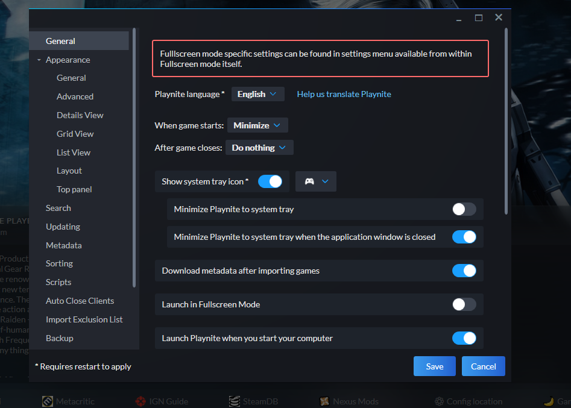

# Darker Helium
A darker variant of [Helium](https://github.com/darklinkpower/Helium), the Steam-inspired theme for [Playnite](https://github.com/JosefNemec/Playnite) Desktop Mode.

> **Credits:** Darker Helium is a fork of Helium by [darklinkpower](https://github.com/darklinkpower). All the original design and work belongs to him. This fork is based on Helium 1.71 and is not affiliated with or supported by the original author.

## What's different
- A darker color palette compared to the original Helium, to match the modern Steam UI.
- The achievements button now opens the achievements list. Works with [Playnite Achievements](https://github.com/justin-delano/PlayniteAchievements).
- Everything else (layouts, extension support, ThemeModifier options) is inherited from Helium.

## Installation
1. Download the latest packaged `pthm` theme file from the [Releases page](https://github.com/pahan3000/Darker-Helium/releases/latest).
2. Open the file and Playnite will install the theme.
3. In Playnite, go to **Settings → Appearance → General** and select **Darker Helium**.

Darker Helium has its own theme ID, so it installs alongside the original Helium instead of replacing it.

## Support and feature requests
If you encounter a bug or have a suggestion, please open an issue in the [Issues Tracker](https://github.com/pahan3000/Darker-Helium/issues).

This is a hobby project, so changes that benefit most users are prioritized over very personal tweaks.


## Screenshots





## Building the theme
The theme files live in the [`source`](source) folder. To package them into an installable `.pthm` file:

### Option A: Playnite Toolbox (recommended)
1. Make sure `theme.yaml` in `source` has the correct `Id`, `Name`, `Author` and `Version`.
2. Open a terminal in your Playnite installation folder, where `Toolbox.exe` is located.
3. Run:
   ```
   Toolbox.exe pack "C:\path\to\Darker-Helium\source" "C:\path\to\output"
   ```
4. The packaged `.pthm` file is created in the output folder, named after the theme ID and version.

## License and credits
Released under the same license as the original project, see [LICENSE](LICENSE). Original theme by [darklinkpower](https://github.com/darklinkpower/Helium).
